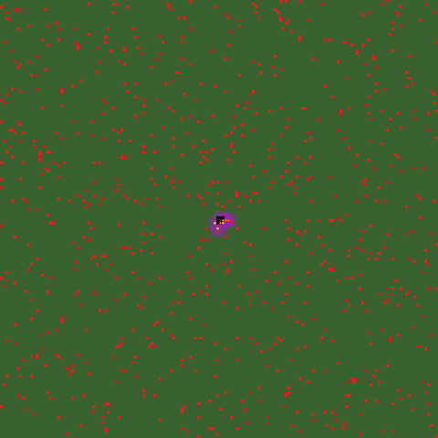
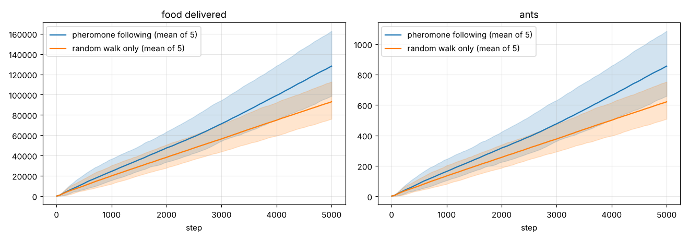

# Ant Simulation

Ants forage from a nest using pheromone trails. They leave the nest and search. When they see food they fetch it and carry it home, laying pheromone on both legs. Other ants follow that pheromone outward to the food. Every 150 units of food delivered, the nest makes a new ant.



*Seed 4, 4000 steps. Purple is pheromone (log scale), red is food, black is the nest. Ants are white when searching, yellow when heading to food, orange when carrying food home.*

## Build and run

You need a C++17 compiler. [SFML](https://www.sfml-dev.org/) 2.5+ or 3 is needed for the viewer only. [doctest](https://github.com/doctest/doctest) is needed for the tests.

```bash
sudo apt install libsfml-dev doctest-dev     # Debian / Ubuntu
make            # ./ants (viewer + headless)
make headless   # ./ants-headless, no SFML needed
make test

./ants                                   # viewer
./ants --seed 4 --no-pheromones          # control: searching ants only random-walk
./ants --no-window --steps 5000 --seed 1 --csv stats.csv
./ants --no-window --steps 4000 --dump-dir frames --dump-every 50 --scale 3
python tools/render_gif.py frames --out ants.gif
```

CMake works too, including on Windows:

```bash
cmake -S . -B build && cmake --build build && ctest --test-dir build
```

Options:
- `--size WxH`
- `--ants N` (initial ants)
- `--evaporation E`
- `--food-per-ant N`
- `--max-ants N`
- `--every N` (CSV interval)

All other parameters are in `ants::Params` (`include/ants/colony.hpp`).

**Viewer controls:**
- **space**: pause
- **↑ / ↓**: steps per frame
- **mouse wheel**: zoom
- **right drag**: pan
- **R**: reset the view
- **P**: toggle pheromone following
- **N**: new world
- **Esc**: quit

## The model

The world is a 160 × 160 grid. Each tile has a 3 % chance of a food pile of 500–1000 units. The nest is in the centre. Each step, every ant acts according to its state.

**Searching.** The ant moves, then looks for food within 3 tiles in every direction and targets the nearest pile.
- Without pheromone nearby, it random-walks: x and y each change by −1, 0 or +1.
- With pheromone nearby, it steps to one of the 9 surrounding tiles, staying put included, with probability proportional to that tile's pheromone.
- After 4–8 following steps it takes a random-walk break of 3–8 steps, so ants don't get trapped on a trail.

**To food.** The ant lays pheromone and steps diagonally towards the pile. On arrival it takes what it can carry (20–33 units, fixed per ant). If the pile is already gone, it searches again.

**To nest.** The ant lays pheromone, walks home and drops the food.

**Pheromone deposit.** An ant at distance $d$ from the nest lays

$$\phi = \phi_0 \cdot 1.25^{\,d}, \qquad \phi_0 = 50 \text{ (to food)},\ 10 \text{ (to nest)},$$

spread over a 5 × 5 block:
- $\phi$ on its own tile
- $\phi/3$ within Manhattan distance 2
- $\phi/9$ on the corners

Because deposits grow with distance, a trail is stronger towards its far end. Following the concentration therefore leads *away* from the nest, towards the food, and a single pheromone type does the job of the usual "home" and "food" pair. Pheromone evaporates by 25 % per step, and is set to 0 below 0.5.

## Do the trails help?

Five seeds, 5000 steps each (`tools/experiment.sh`, `tools/plot_foraging.py`). The same colonies are run with pheromone following on and off. With it off, ants still lay pheromone but ignore it.



| seed | food delivered, with pheromones | random walk only | ratio |
|---|---|---|---|
| 1 | 138 454 | 97 340 | 1.42 |
| 2 | 98 586 | 76 075 | 1.30 |
| 3 | 118 497 | 90 826 | 1.30 |
| 4 | 162 845 | 112 759 | 1.44 |
| 5 | 122 279 | 87 899 | 1.39 |

Pheromone following delivers 30–44 % more food on every seed, 38 % more on average. The colony grows with the food (one ant per 150 units), so the advantage compounds over time.

## Changes from the 2017 version

The model and its constants are the same. These bugs are fixed:

- **Out-of-bounds reads:**
  - Food detection had no bounds check, so ants within 3 tiles of the edge read outside the grid.
  - The random walk allowed `x == width`.
  - The weighting loop in pheromone detection was unchecked.
  - The deposit check used `> 0`, which skipped row and column 0.
- **Phase timers:** the follow and random-walk timers were decremented below 0 and compared with `== 0`, so after the first cycle ants never switched phase again.
- **Food was created from nothing:**
  - An ant always took its full capacity, even from a smaller pile.
  - It still "collected" from a pile another ant had already emptied.
- **Food detection:** the range was asymmetric (−r … r−1), and it took the last pile scanned, not the nearest.
- **Smaller bugs:** `setMemory` wrote x twice, `setFoodDetectionRange` added instead of setting, and hunger and memory were unused (now removed).
- **Speed:** drawing was O(tiles × ants) every frame; the map is now one texture.
- **Reproducibility:** three RNGs seeded with `time(NULL)` are replaced by one seeded generator.
- **Platform:**
  - It was Windows-only (`Windows.h`, `conio.h`).
  - Build output (objects, PDBs, the .exe, DLLs, about 12 MB) was committed.

The tests (doctest, run under ASan and UBSan in CI) cover:
- food conservation and the nest bookkeeping
- ants inside even 5 × 5 worlds
- capacity limits
- seed determinism
- symmetric, nearest-first food detection
- an emptied pile
- the deposit kernel at the border
- that the following probabilities match the pheromone ratios
- the phase timers
- evaporation and the floor
- the ant cap

## Layout

```
include/ants/   colony.hpp (model), render.hpp (RGB frames)
src/main.cpp    viewer and headless runner
tests/          doctest suite
tools/          experiment.sh, plot_foraging.py, render_gif.py
results/        CSVs of the experiment above
```
